<div align="center">

# HA Studio

**Plan, design and generate business-grade Home Assistant dashboards — KPIs, per-device energy, cameras, infrastructure, backups and voice — from one portable AI skill.**

[Arabic / عربي](README.ar.md) · [Claude](#claude-code) · [Claude.ai](#claudeai) · [Codex](#codex-openai) · [ChatGPT](#chatgpt) · [Gemini](#gemini) · [Antigravity](#antigravity)

[](LICENSE)
[](https://agentskills.io)
[](https://www.python.org)
[](https://github.com/DXBMARK/ha-studio/actions/workflows/ci.yml)
[](https://github.com/DXBMARK/ha-studio/actions/workflows/codeql.yml)
[](https://github.com/DXBMARK/ha-studio/releases)
[](https://github.com/DXBMARK/ha-studio/stargazers)

by **DXBMARK LLC**

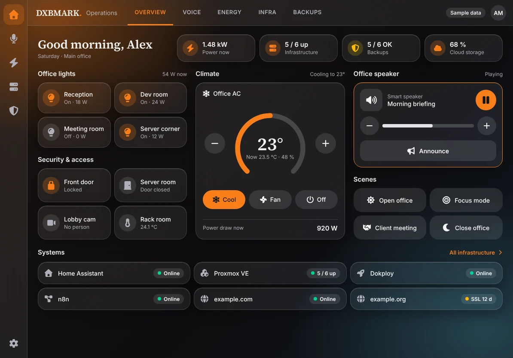

</div>

> Independent project. Not affiliated with, endorsed by or certified by Home Assistant, the Open Home Foundation or any AI vendor named here. "Home Assistant" is used only descriptively ("compatible with Home Assistant"). See [TRADEMARKS.md](TRADEMARKS.md).

---

## Why this exists

Most Home Assistant (HA) dashboards are hobby layouts. A business needs answers at a glance: *Is power normal? Which device is wasting energy? Are the cameras up? Are our sites, certificates and backups healthy?* HA Studio gives an AI assistant a complete, repeatable method — and the tools — to deliver that safely.

| You say | It does |
|---|---|
| "Design a dashboard for our office iPad" | Intake → inventory → KPI plan → Lovelace YAML + theme + preview |
| "Show energy per device" | Energy audit (missing kWh sensors, wrong `state_class`, untracked load) + Energy view |
| "Add the new cameras and AC units" | Re-inventory, diff, classify, regenerate |
| "Monitor Proxmox, Dokploy, our domains and backups" | HA-native recipes (official integrations, REST/template sensors, alerts) |
| "One view per room, staff vs admin" | Rooms view from your area map; admin-only tabs via core view `visible` |
| "Make it look like our brand" | Three accessibility-checked glass variants; tokens → HA theme |

## What you get

- **A skill** (`skills/ha-studio/`): workflow, 10 reference guides, 7 business profiles (office, retail, cafe, clinic, hotel, warehouse, devops).
- **Tools** (Python, stdlib + PyYAML): read-only inventory, energy audit, Lovelace generator, theme generator, WCAG contrast checker, dashboard validator, HTML preview builder, screenshot tools, skill linter.
- **Three approved glass designs** — Aurora, Midnight, Frost — with tokens, HA themes and previews.
  Note: Home Assistant officially documents only a few theme variables (e.g. `primary-color`, `accent-color`); the glass look also uses `ha-card-*` and `card-background-color`, which are not officially documented and may change between releases. Re-check the look after Home Assistant updates.
- **Release tooling**: claude.ai ZIP, ChatGPT pack, Gemini Gem text, safe installer, CI.
- **Tests**: `pytest` suite covering generation, validation, contrast, packaging, licence and secret hygiene.

## Screenshots

All screenshots are generated from sample data (fictional users, `example.com` hosts) by `tools/make_screenshots.py` — no real customer data. The HTML previews load fonts from Google Fonts at view time (which sends the viewer's IP to Google); self-host the OFL fonts if that matters to you.

*Icons: Font Awesome Free by Fonticons, Inc., CC BY 4.0.*

| Aurora — dark / orange | Midnight — navy / sky | Frost — light |
|---|---|---|
| 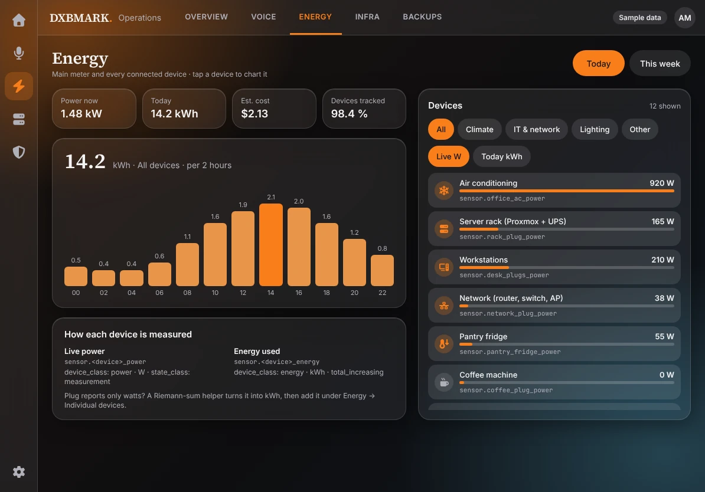 | 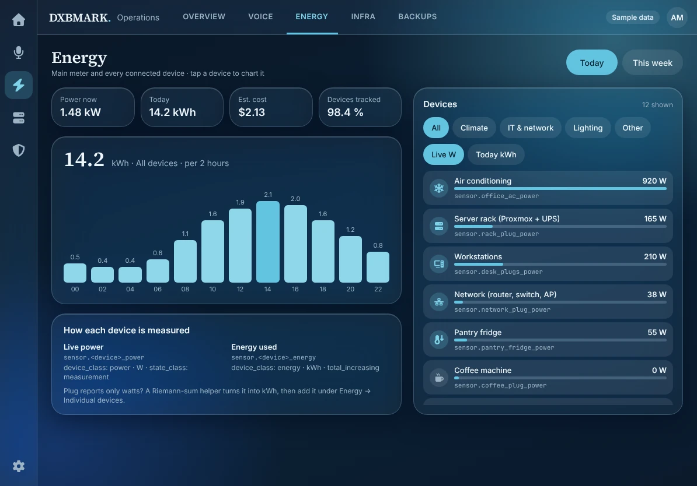 | 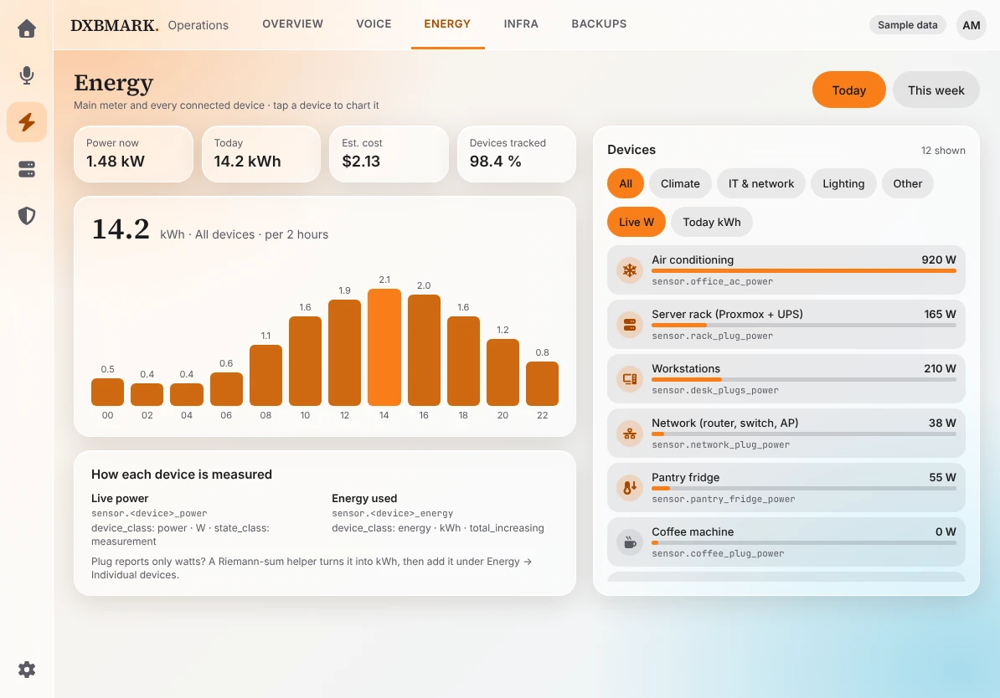 |
| 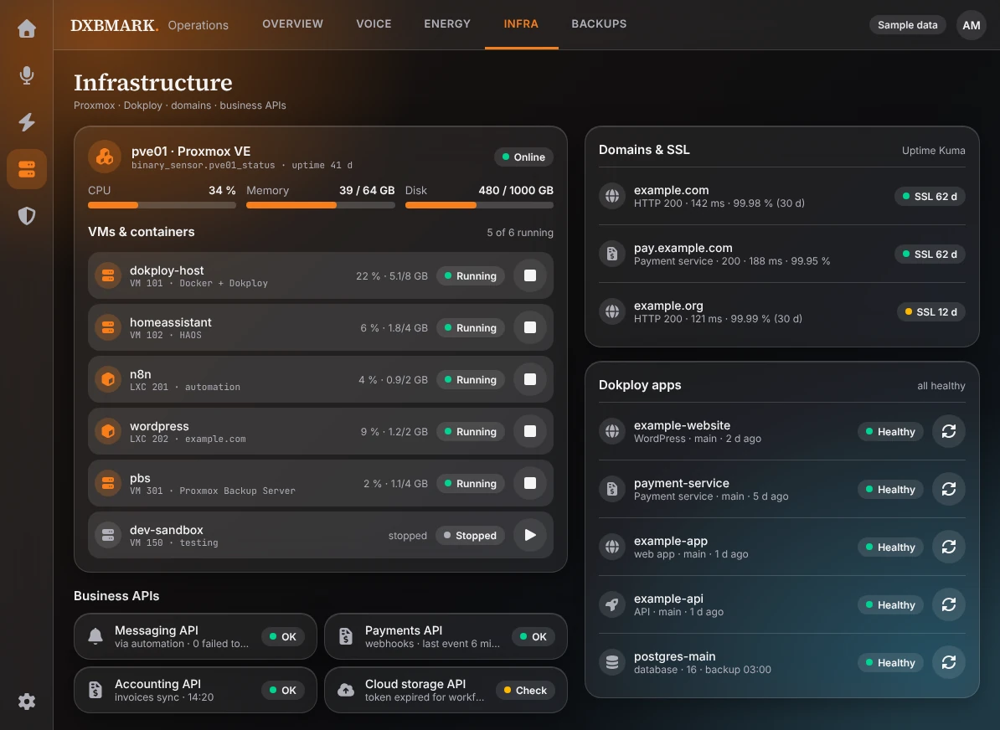 | 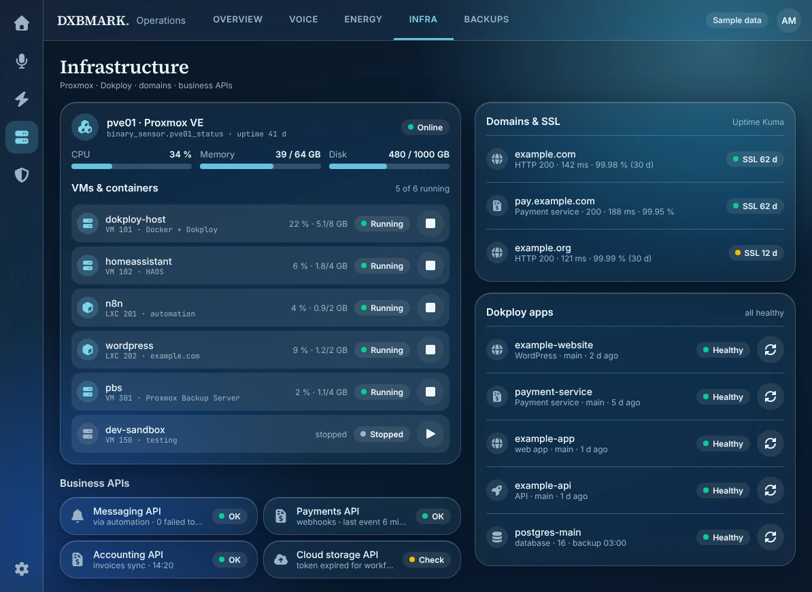 | 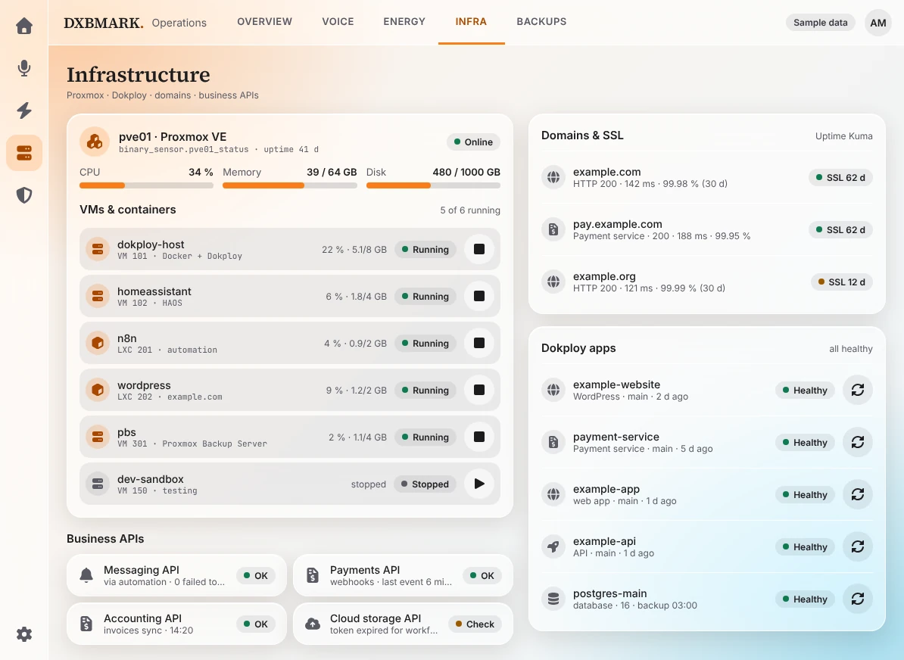 |
| 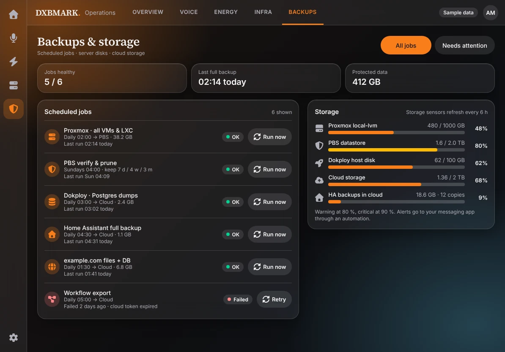 | 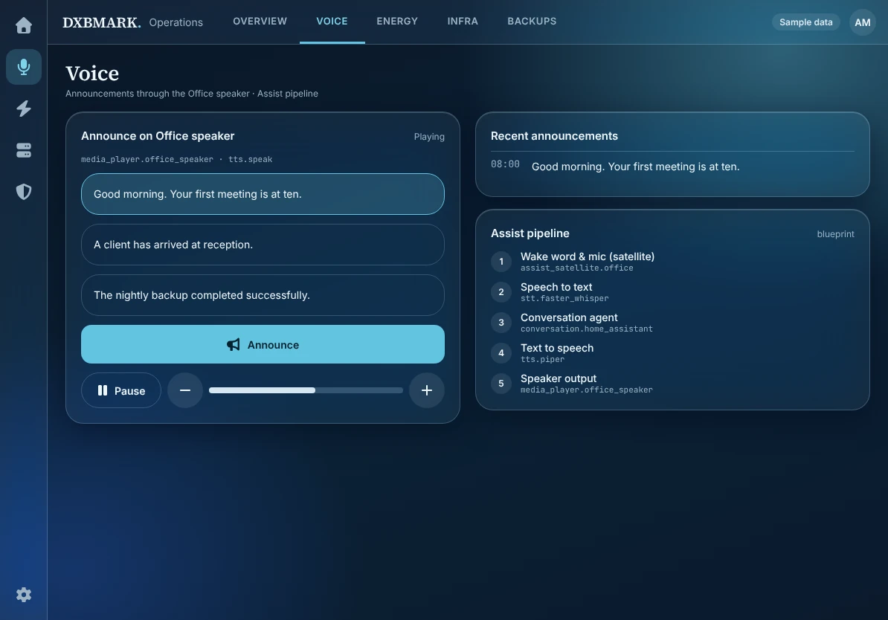 | 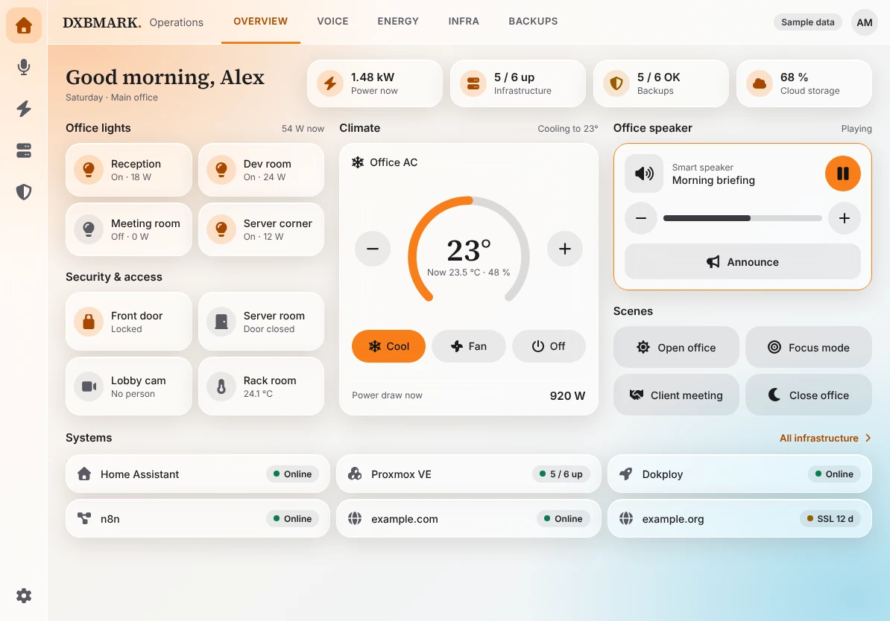 |

**Components, palette and measured contrast**

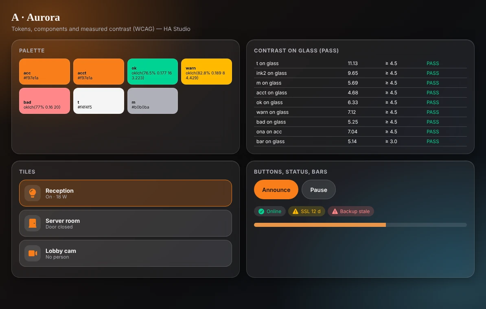
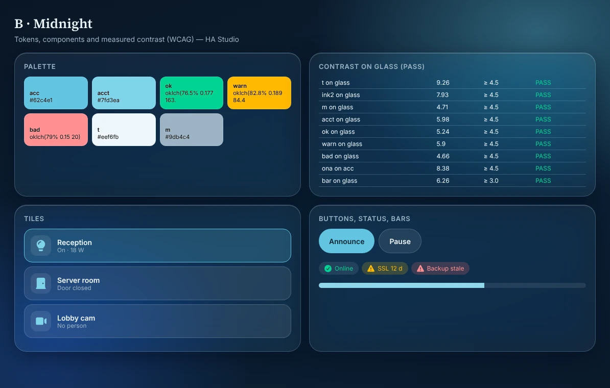
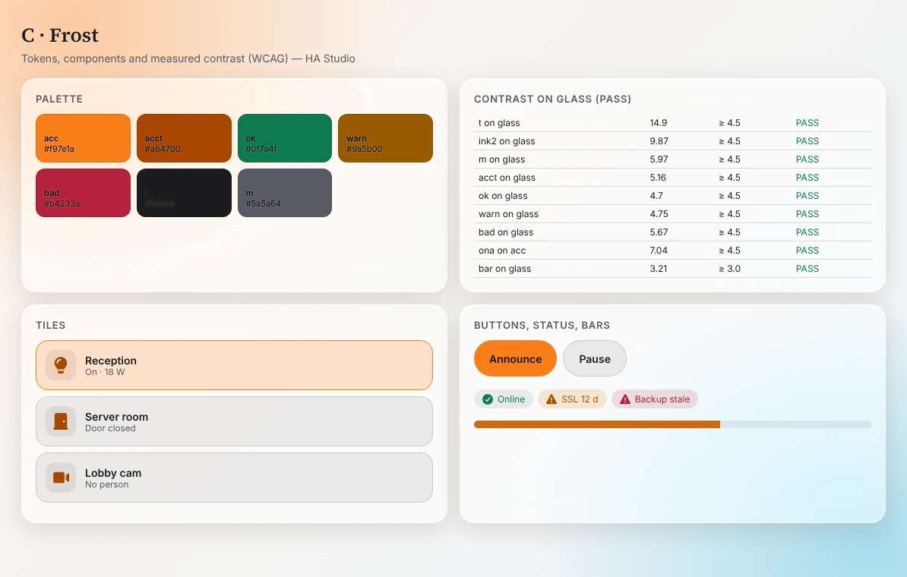

**Icon set** (55 preview glyphs; HA dashboards use `mdi:` names)

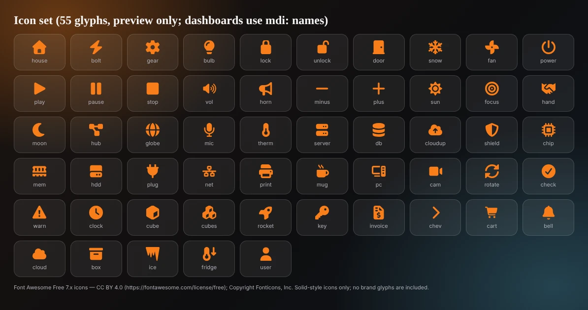

## Install

Pick your platform. The skill is one folder in the open [Agent Skills](https://agentskills.io) format; adapters only package it. 

### Claude Code

```text
/plugin marketplace add DXBMARK/ha-studio
/plugin install ha-studio@dxbmark
```
Manual alternative:
```bash
git clone https://github.com/DXBMARK/ha-studio && cd ha-studio
python3 tools/install.py --target claude-code-user          # dry run
python3 tools/install.py --target claude-code-user --yes    # installs to ~/.claude/skills
```
Then ask: *"Use ha-studio to design a dashboard for my office."*

### Claude.ai
1. Download `ha-studio-<version>.zip` from the repository's **Releases** (or run `python3 tools/build_release.py`).
2. In Claude: **Settings → Capabilities → Skills → Upload skill** (menu labels may vary), select the ZIP.
3. Requires a plan with skills and code execution enabled. Start a chat describing your Home Assistant dashboard task.

Claude API: upload the same folder through the Skills API and attach it with `container.skills` (the container has no network, so use `--states-file` exports).

### Codex (OpenAI)
```bash
python3 tools/install.py --target codex-repo --dest /path/to/your/project --yes   # → .agents/skills/
python3 tools/install.py --target codex-user --yes                                 # → ~/.agents/skills/
```
Invoke with `$ha-studio` or just describe the task. The included [AGENTS.md](AGENTS.md) points Codex at the skill.

### ChatGPT
ChatGPT has no install-from-GitHub. Choose one:
- **Skills** (Business / Enterprise / Edu, if enabled by your admin): upload the skill ZIP. *Upload format not verified by DXBMARK.*
- **Project** (Plus/Pro): create a Project, paste `chatgpt/instructions.md` (≈3.6k characters) as instructions and upload the files from `chatgpt-pack-<version>.zip → knowledge/`.
- **Free/Go or custom instructions**: paste `chatgpt/instructions-lite.md` (≈0.7k characters).

### Gemini
- **Gemini CLI** (enterprise licences — consumer CLI access ended 18 June 2026): `gemini skills install https://github.com/DXBMARK/ha-studio --consent`, or install as an extension via `gemini-extension.json` (loads `GEMINI.md`).
- **Gemini app**: create a **Gem** and paste `gem-instructions.md` (from the release assets). Gems cannot run the scripts; you get the method and YAML authoring.

### Antigravity
```bash
python3 tools/install.py --target antigravity-project --dest /path/to/project --yes   # → .agents/skills/
python3 tools/install.py --target antigravity-user --yes                              # global skills folder
```
Global paths differ between Antigravity versions — confirm in its current documentation. Installing from a GitHub URL was not verified.

> The installer **never overwrites** an existing install and does nothing without `--yes`.

## Quick start (no AI needed)

```bash
pip install PyYAML
S=skills/ha-studio/scripts

# 1) Inventory (read-only). Token stays in the environment.
HA_URL=https://homeassistant.local:8123 HA_TOKEN=... python3 $S/ha_inventory.py --out inventory.json   # use https (or a trusted LAN); redirects are refused so the token never leaves your host
#    …or offline from an export, e.g. the bundled demo:
python3 $S/ha_inventory.py --states-file skills/ha-studio/assets/examples/demo_states.json --out inventory.json

# 2) Energy audit
python3 $S/energy_audit.py inventory.json --tariff 0.15

# 3) Generate theme + dashboard, then validate
python3 $S/gen_theme.py aurora --out themes/dxbmark_aurora.yaml
python3 $S/generate_lovelace.py inventory.json --profile office --theme dxbmark_aurora --title "My Office" --out dashboard.yaml
#    Optional: --areas areas.yaml adds a Rooms view; --admin-user <HA user id> hides Energy/Security/Infra/Backups from other users
python3 $S/validate_dashboard.py dashboard.yaml --inventory inventory.json

# 4) Optional: iPad HTML previews and screenshots (needs Playwright)
python3 $S/build_design.py --out preview/ --brand "My Company"
```
The scripts never overwrite an existing output file unless you pass `--force`. Apply by pasting `dashboard.yaml` into a dashboard's raw configuration editor, or reference it from a YAML-mode dashboard. Use `assets/examples/packages/dxbmark_infra.yaml` as a starting point for Proxmox/Dokploy/certificate/backup KPIs.

## Try it locally (one command)

```bash
pip install -r requirements-test.txt
python3 tools/serve_demo.py            # builds everything on the bundled demo data, then serves http://127.0.0.1:8099/
```
It runs the whole pipeline (inventory → energy audit → theme → Lovelace dashboard with Rooms view and admin-only tabs → validation → contrast report → three interactive iPad previews → component and icon sheets) and opens an index page with every result. Nothing leaves your computer. Use `--states-file my_states.json` for your own Home Assistant export, `--port` to change the port, `--no-serve` to build only.

### Why a Docker image?
Optional. The skill itself needs no Docker. The image `ghcr.io/dxbmark/ha-studio` ([GitHub Packages](https://github.com/orgs/DXBMARK/packages?repo_name=ha-studio)) bundles Python and PyYAML so the command-line tools run on a server or CI without installing anything:
```bash
docker run --rm -v "$PWD":/work ghcr.io/dxbmark/ha-studio:1.1.0 generate_lovelace inventory.json --profile office --out dashboard.yaml
docker run --rm ghcr.io/dxbmark/ha-studio:1.1.0 --help      # list the tools
```
It runs as a non-root user and makes no network calls on its own. GitHub Packages has no Python index, so a container is how this repository publishes a package.

## How the skill works

```
Intake → Inventory → Classify & KPI plan → Energy audit → Design → Generate → Preview → Validate → Deliver
```
- **Read-only by default.** It never calls HA services or edits your configuration; applying changes needs your explicit yes.
- **Never invents entities.** Missing KPIs are reported as gaps with the integration/helper that would create them.
- **Secrets stay out.** Tokens via environment or `!secret`; validators reject secret-like strings.
- **Cameras are privacy-sensitive.** Opaque tiles, snapshots first, restricted views, audio off.
- **Honest about limits.** [verification-checklist.md](skills/ha-studio/references/verification-checklist.md) lists what was *not* tested on a live instance.

## Design system

Glass that stays readable: text ≥ 4.5:1 and UI marks ≥ 3:1 measured on the composited card (`contrast_check.py`), opaque fallbacks for `prefers-reduced-transparency`, `prefers-contrast` and `forced-colors`, 48 px touch targets, state matrix for every widget. Details: [design-system.md](skills/ha-studio/references/design-system.md).

## Repository layout

```
skills/ha-studio/   the skill (SKILL.md, scripts/, references/, assets/)
.claude-plugin/             Claude Code plugin + marketplace manifests
chatgpt/                    ChatGPT instructions (full + lite)
tools/                      build_release.py, install.py, make_screenshots.py, serve_demo.py
tests/                      pytest suite          docs/screenshots/  README images
AGENTS.md  GEMINI.md  gemini-extension.json      platform adapters
README.ar.md                                      Arabic (full translation)
LICENSE  NOTICE  THIRD_PARTY_NOTICES.md  TRADEMARKS.md  SECURITY.md  CONTRIBUTING.md  VERSIONING.md  CHANGELOG.md
```

## Development

```bash
pip install -r requirements-dev.txt
pytest -q
python3 skills/ha-studio/scripts/lint_skill.py
python3 skills/ha-studio/scripts/contrast_check.py
python3 tools/build_release.py        # → dist/
python3 tools/make_screenshots.py     # regenerate docs/screenshots (needs Playwright + Chromium)
```

## Ownership, licence and third-party rights

- **Owner:** DXBMARK LLC. All original content — skill, code, tokens, templates, text, screenshots of DXBMARK mock-ups — is © 2026 DXBMARK LLC, released under the **Apache License 2.0** ([LICENSE](LICENSE), [NOTICE](NOTICE)). The DXBMARK name is a trademark of DXBMARK LLC and is not licensed.
- **Third parties keep their rights.** Font Awesome Free (CC BY 4.0), fonts (OFL 1.1), Material Design Icons (Apache-2.0) and others are credited in [THIRD_PARTY_NOTICES.md](THIRD_PARTY_NOTICES.md). Home Assistant documentation (CC BY-NC-SA 4.0) is **not** copied; facts are restated in original wording. No Home Assistant logo is used. n8n is optional and not redistributed.
- **Not legal advice.** Camera/privacy notes are engineering guidance; check the laws that apply where you deploy before installing cameras.

## Third-party components

Everything below belongs to its owners and keeps its own licence; full text and usage in [THIRD_PARTY_NOTICES.md](THIRD_PARTY_NOTICES.md).

| Component | Licence | Use |
|---|---|---|
| [Font Awesome Free](https://fontawesome.com/license/free) | CC BY 4.0 (icons) | 55 solid icons as SVG paths, preview only |
| [ui-ux-pro-max](https://github.com/nextlevelbuilder/ui-ux-pro-max-skill) | MIT | Bundled unmodified in `vendor/`, with its LICENSE |
| Inter, Source Serif 4, JetBrains Mono | SIL OFL 1.1 | Preview typography (loaded from Google Fonts) |
| Material Design Icons | Apache-2.0 | `mdi:` names only |
| Home Assistant | Apache-2.0 (code) | Target platform, referenced only; documentation (CC BY-NC-SA) not copied |
| PyYAML, pytest, Playwright | MIT / Apache-2.0 | Installed by the user, not redistributed |
| shields.io, GitHub Actions, Docker `python:3.12-slim` | their terms | README badges, CI and the container image |

## Contributing & security

See [CONTRIBUTING.md](CONTRIBUTING.md) (DCO sign-off, original wording only), [SECURITY.md](SECURITY.md) and [VERSIONING.md](VERSIONING.md) (SemVer, release steps).

---

<div align="center">

### Get in touch

[](https://www.dxbmark.com)
[](mailto:info@dxbmark.com)
[](https://www.linkedin.com/company/dxbmark)
[](https://wa.me/971505121583)

<sub>© 2026 DXBMARK LLC · Apache-2.0 · Dubai, UAE &nbsp;|&nbsp; ⭐ Star the repo if HA Studio helps your business</sub>

</div>
